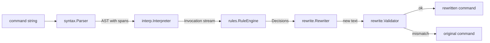

# bashlight — design

bashlight sits between an LLM agent and the shell. When the agent runs a bash command,
bashlight parses it, pre-interprets it **statically** (nothing is executed), finds every
command that will run, and lets a set of rules rewrite the ones that do not match the
project's conventions (`pip install foo` in a Poetry project → `poetry add foo`). The
rewritten command is what actually runs; the agent keeps seeing its own command in the
history.

This document is the contract between modules. Every contributor (human or agent) must
read it before touching code.

## Engineering principles (non-negotiable)

1. **No global state.** No module-level mutable variables, no singletons, no
   module-level caches. State lives in instances created by a composition root
   (`createBashlight()` in `src/bashlight.ts`). Module-level `const`s holding immutable
   data (tables of known commands, regexes) are fine.
2. **Inversion of control / dependency injection.** Collaborators are passed through
   constructors (or factory parameters), typed by interfaces. Nothing reaches out to
   `process.env`, `node:fs`, the clock or the console directly except the adapters that
   implement the injected interfaces (`NodeFileSystem`, the OpenCode plugin entry
   point).
3. **Cohesive modules, logical classes.** One concept per file. When several functions
   share the same parameters, they are a class holding those parameters. Strategy-like
   variation (wrappers, rules, detectors) is expressed as an interface plus one class
   per strategy, registered in a list — never a growing `switch`.
4. **No duplication.** Anything implemented twice is factored. Shared command line
   knowledge (e.g. "is this argv a Python invocation, through which runner?") lives in
   one place and is reused by every rule.
5. **Fail open.** bashlight must never break a command. Unparseable input, unknown
   values, edit conflicts, validation failures: the original command runs untouched.
   Only an explicit `block` verdict stops a command.
6. **Pure core.** `syntax`, `interp`, `rewrite` and `rules` are pure functions of their
   inputs plus injected interfaces; they are tested without touching the disk.
7. Style: TypeScript strict, ESM, 4-space indent, 88 columns, trailing commas
   (prettier), eslint (typescript-eslint type-checked, sonarjs, sorted imports).
   `bun test`. Prefer `readonly` everywhere, discriminated unions with a `kind` field,
   no `any`, no non-null assertions unless proven.

## Pipeline



`Bashlight.process(command, { cwd, env }) → Outcome`, where

```ts
type Outcome =
    | { kind: "unchanged"; reason?: string }
    | { kind: "rewritten"; command: string; changes: readonly Change[] }
    | { kind: "blocked"; message: string };
```

## Modules

```
src/
  syntax/    lexer, parser, AST (with exact source spans)
  interp/    static pre-interpreter: environment, word expansion, wrappers
  project/   project inspection (python/node toolchains) over a FileSystem
  rules/     Rule interface, RuleEngine, shared command knowledge, built-ins
  rewrite/   edit planning, shell quoting, re-validation
  opencode/  OpenCode plugin adapter
  bashlight.ts  composition root (createBashlight)
  index.ts      public exports
```

Dependency direction: `syntax` ← `interp` ← `rules` ← `rewrite` ← `bashlight` ←
`opencode`. `project` only depends on its `FileSystem` interface; `rules` depend on
`project` interfaces. No cycles.

### syntax — parser

Hand-written lexer + recursive-descent parser (bash's context-sensitive lexing —
heredocs, nested `$(…)` containing `case … )`, `[[ ]]`, arithmetic — makes a PEG grammar
more painful than helpful). Supports the bash subset LLMs actually write:

- lists `;` `&` newline, `&&` `||`, pipelines `|` `|&`, `!`, `time`
- simple commands: prefix assignments (`A=1 B+=x cmd`, arrays `A=(x y)`), words,
  redirections anywhere (`>`, `>>`, `<`, `2>&1`, `&>`, `<<<`, `<<EOF`, `<<-'EOF'`, `<>`,
  `>|`, `{fd}>`)
- compound: `( … )`, `{ …; }`, `if/elif/else`, `for x in …`, `for ((…))`, `while`,
  `until`, `case`, `select`, function definitions (`f() {}`, `function f {}`),
  `(( … ))`, `[[ … ]]`, `coproc` (as opaque)
- words: unquoted text, `'…'`, `"…"`, `$'…'`, `$"…"`, backslash escapes, `$x`, `${…}`
  with all operators (`:-` `-` `:=` `:?` `:+` `#` `##` `%` `%%` `/` `//` `^` `,` `#x`
  `!x` `x[i]` `x:o:l` `@Q`…), `$(…)`, `` `…` ``, `$((…))`, `<(…)` `>(…)`, `~` prefixes,
  brace expansion, globs (kept as literal with an `unquoted` flag), comments.

Every node carries a `span: { start, end }` (UTF-16 offsets into its
`SourceDocument.text`). Every word part distinguishes its **raw** span (source text)
from its **value** (after quote removal) so the rewriter can edit precisely and know the
quoting context of each character.

API:

```ts
class Parser {
    parse(doc: SourceDocument): ParseResult; // never throws
}
type ParseResult = { ok: true; script: Script } | { ok: false; error: ParseError }; // error has message + span
```

`SourceDocument { text: string; parent?: NestedOrigin }` — the top-level command is a
document; a script found inside another (`bash -c '…'`, `ssh host '…'`, `eval '…'`) is a
nested document whose `parent` links to the outer `Arg` it was read from.

### interp — static pre-interpreter

`Interpreter` walks the AST with an `Environment` and emits `Invocation`s (every simple
command that would execute, in source order, including those inside `$(…)`, functions,
loops and branches).

**Values and origins.** Expansion produces `Arg`s, each made of `Fragment`s:

```ts
interface Fragment {
    readonly text: string | undefined; // undefined = statically unknown
    readonly origin: Origin;
}
type Origin =
    | { kind: "literal"; doc: SourceDocument; span: Span } // source chars
    | { kind: "binding"; binding: Binding; use: ParameterExpansion } // $VAR
    | { kind: "computed"; node: Node } // ~, $((1+1)), ${#x}, brace exp…
    | { kind: "unknown"; node: Node; reason: string }; // $(…), $1, read…

interface Arg {
    readonly fragments: readonly Fragment[];
    readonly value: string | undefined; // join of fragments, or unknown
    readonly word: Word; // the source word it came from
    readonly doc: SourceDocument;
    readonly field: { index: number; count: number }; // field splitting
}

interface Binding {
    readonly name: string;
    readonly value: readonly Fragment[]; // expanded value at assignment time
    readonly assignment: Assignment | undefined; // undefined: initial env
    readonly doc: SourceDocument | undefined;
    readonly exported: boolean;
}
```

So with `P="poetry run python"; $P a.py`, the invocation argv is `poetry`, `run`,
`python` (origin `binding` P, fields 0..2 of the word `$P`) and `a.py` (origin
`literal`).

**Environment** (immutable-style; `fork()` for subshells / pipeline members / `$(…)`;
`merge()` after branches: a variable that differs across branches becomes unknown):

- shell variables and exported flag (`A=1`, `export A=1`, `export A`, `declare -x`,
  `local`, `readonly`, `unset`); prefix assignments only apply to their command; unset
  variables that are not in the initial environment are **unknown**, not empty (we do
  not know the real shell's environment).
- `cwd: string | undefined` — tracked through `cd`, `pushd`, `popd`, `cd -`, `cd` (→
  `$HOME`); relative paths resolved against the current cwd; unknown target ⇒ cwd
  unknown.
- positional parameters unknown at top level; bound inside function calls.
- functions: definitions are recorded; a call to a defined function is reported as an
  `Invocation` with `kind: "function"` (rules ignore it) and its body is interpreted at
  the call site with the call's arguments (depth-capped). Bodies of functions never
  called are interpreted once with unknown positionals so that their commands are still
  visited.
- loops: the body is visited once; the loop variable is bound to its single value when
  the list has one known item, otherwise unknown. Variables assigned in a loop body are
  unknown after the loop.
- `source`/`.`: `X/bin/activate` sets `VIRTUAL_ENV=X` and prepends `X/bin` to `PATH` (we
  model the effect); other files are recorded in `environment.sourced` and otherwise
  ignored.

**Wrappers.** A `Wrapper` is a strategy that recognizes a command that runs another
command, and describes how:

```ts
interface Wrapper {
    readonly name: string;
    unwrap(argv: readonly Arg[], context: ExecutionContext): Unwrapped | undefined;
}
type Unwrapped =
    | { kind: "argv"; offset: number; context: ExecutionContext } // env, sudo,
    // timeout, nice, nohup, command, exec, stdbuf, xargs, docker exec/run,
    // kubectl exec, poetry run? NO (runners belong to rules, see below)
    | { kind: "script"; script: Arg; context: ExecutionContext }; // bash -c,
// sh -c, zsh -c, ssh host 'cmd…' (args joined), eval
```

Wrappers are registered in a `WrapperRegistry` (constructor-injected list); they are
applied repeatedly (`sudo env A=1 timeout 5 python x`). `env A=1` and `sudo -E` update
the inner environment. Remote wrappers (`ssh`, `docker exec`, `docker compose exec`,
`kubectl exec`) produce a context with `host: { kind: "remote", via, target }` and
`cwd: undefined`.

Runners of a project toolchain (`poetry run`, `uv run`, `npx`, `pnpm exec`…) are **not**
wrappers: they are what rules reason about.

```ts
interface ExecutionContext {
    readonly cwd: string | undefined;
    readonly host: Host; // { kind: "local" } | { kind: "remote"; via; target }
    readonly env: EnvironmentView; // lookup(name) → value|undefined|"unset"
}

interface Invocation {
    readonly kind: "external" | "builtin" | "function";
    readonly command: SimpleCommand; // AST node
    readonly doc: SourceDocument;
    readonly fullArgv: readonly Arg[]; // as written, after expansion
    readonly offset: number; // where the effective command starts in fullArgv
    readonly argv: readonly Arg[]; // fullArgv.slice(offset)
    readonly wrappers: readonly string[]; // names of peeled wrappers
    readonly context: ExecutionContext;
}
```

The interpreter has no I/O. Unknowns never stop it; it records why something is unknown.

### project — toolchain inspection

```ts
interface FileSystem {
    exists(path: string): boolean;
    isDirectory(path: string): boolean;
    readText(path: string): string | undefined;
}
```

Implementations: `NodeFileSystem` (real disk, only used by the composition root) and
`MemoryFileSystem` (tests, corpus fixtures).

`ProjectInspector` (one instance per processed command, so it may memoize freely)
answers, for a directory:

- `python(dir): PythonToolchain | undefined` —
  `{ manager: "poetry" | "uv" | "pipenv" | "pdm" | "hatch" | "venv", root, venv?: string, declares(pkg): boolean }`.
  Detection by lockfiles first, then pyproject sections, then a bare `.venv`/`venv` with
  `bin/python`.
- `node(dir): NodeToolchain | undefined` —
  `{ manager: "npm" | "pnpm" | "yarn" | "bun", root, declares(pkg): boolean }`.
  `packageManager` field first, then lockfiles, walking up to the workspace root.

Each ecosystem is a `ToolchainDetector` strategy; adding Ruby/Go later means adding a
detector, not editing the inspector.

### rules — the extension point

```ts
interface Rule {
    readonly id: string;
    inspect(call: CommandCall, context: RuleContext): Verdict;
}

interface CommandCall {
    readonly argv: readonly CallArg[]; // effective command, argv[0] known
    readonly env: EnvironmentView; // incl. prefix assignments
}
interface CallArg {
    readonly value: string | undefined;
    readonly origin: "literal" | "variable" | "computed" | "unknown" | "mixed";
}
interface RuleContext {
    readonly cwd: string | undefined; // cwd at this exact command
    readonly host: Host;
    readonly project: ProjectInspector;
}

type Verdict =
    | { kind: "keep" }
    | {
          kind: "replace";
          argv: readonly Replacement[]; // new argv
          env?: Readonly<Record<string, string>>; // env injection
          reason: string;
      }
    | { kind: "block"; message: string };

type Replacement = { kind: "arg"; index: number } | { kind: "text"; value: string };
```

Rules receive fully expanded values; they never see origins in detail and never produce
text edits — they say "the new argv is `poetry`, `add`, `argv[2]`…" and the rewriter
figures out how to express it in the source. Helpers (`keep(i)`, `rest(from)`,
`text("poetry")`, `replaceCommand(...)`) make verdicts short.

`RuleEngine` (rules injected, in priority order):

- only `kind: "external"` invocations with a known `argv[0]` are inspected;
  local-host-only rules declare it (`RuleScope`), remote invocations are skipped by
  built-ins;
- a `replace` is fed back into the rules (on the new argv) until no rule changes it, a
  cycle is detected, or 8 rounds pass; replacements compose so the final decision is
  still expressed in terms of the original args;
- the first `block` wins for the whole command.

Shared knowledge used by several rules lives in `rules/knowledge/` (e.g.
`PythonCommandLine` that parses `python -m pip install`, `poetry run pytest`,
`.venv/bin/python`, `uv run --with x python`… into `{ runner, tool, toolArgsOffset }`;
`NodeCommandLine` the same for npm/pnpm/yarn/bun/npx).

Built-in rules (v1), each one class in `rules/builtin/`:

| id                 | does                                                                                                                                                                                                                                                                                          |
| ------------------ | --------------------------------------------------------------------------------------------------------------------------------------------------------------------------------------------------------------------------------------------------------------------------------------------- |
| `python-runner`    | In a Python project, run `python`, `python3`, `pytest`, project tools (`mypy`, `ruff`, `black`, `django-admin`…) through the project's runner (`poetry run`, `uv run`, `pipenv run`, `.venv/bin/x`); fixes the wrong runner (`poetry run` in a uv project). Leaves alone if a venv is active. |
| `pip-to-manager`   | `pip install x` / `python -m pip install x` → `poetry add x` / `uv add x` / `pipenv install x`; `-e .` → `poetry install`/`uv sync`; uninstall → remove; read-only pip commands run inside the project env.                                                                                   |
| `bare-python`      | Outside any Python project: `python …` → `uv run python …`; `pip install` → blocked with a message pointing to PEP 723 scripts + `uv run`.                                                                                                                                                    |
| `node-manager`     | npm/yarn/pnpm/bun mismatch with the project's manager → translated subcommand (`npm install -D x` → `pnpm add -D x`, `npx x` → `pnpm exec x`/`pnpm dlx x`).                                                                                                                                   |
| `redundant-runner` | `poetry run poetry run x`, `uv run uv run x`, `npx npx x`… → single runner.                                                                                                                                                                                                                   |

### rewrite — expressing decisions in source

`Rewriter` turns `(Invocation, Verdict)` pairs into `TextEdit`s on the original text(s),
trying strategies from most to least surgical:

1. **Word-level edit.** Kept args stay untouched. Inserted/replaced/removed args map to
   insertions/replacements/deletions of whole source words whose origin is `literal` and
   which produce exactly one field.
2. **Binding edit.** A contiguous run of replaced args that are exactly all the fields
   of one `$VAR` expansion is rewritten **in the assignment** of that binding — only if
   every use of that binding in the script receives the same change (otherwise strategy
   3).
3. **Inline.** The word containing the expansion is replaced by the quoted new values
   (prefix factorization abandoned for that use).
4. **Regenerate the command's words** (all values known, no redirection interleaved):
   replace the span from the first to the last word of the effective command with the
   quoted new argv.
5. Give up on that invocation (fail-open), keep the others.

Env injection: `K=V ` before the command when it is not wrapped, otherwise `env K=V `
before the effective argv[0].

Nested documents are rewritten bottom-up: the new inner text becomes the new value of
the outer `Arg`, re-quoted in the outer word's quoting style.

`ShellQuoter` produces the minimal safe quoting for a value in a given context
(unquoted, inside `"…"`, inside `'…'`).

**Validator.** The result is re-parsed and re-interpreted; each rewritten invocation
must now produce exactly the intended argv (and untouched invocations must be
unchanged). Any mismatch ⇒ `unchanged` outcome. This self-check is what makes aggressive
rewriting safe.

### opencode — plugin

Targets OpenCode v2 (`@opencode/plugin` ≥ 2.2, promise API: default export
`{ id, setup }`). The adapter registers `ctx.tool.hook("execute.before", …)` and handles
events whose `tool` is `shell` (or legacy `bash`):

- effective cwd = `input.workdir` resolved against the session directory, defaulting to
  it;
- calls `Bashlight.process(command, { cwd, env })`;
- when rewritten, mutates `event.input.command`. OpenCode persists the tool part input
  from the provider's original tool-call event _before_ the hook runs, so the model
  keeps seeing its own command in the history while the rewritten one executes;
- when blocked, throws an `Error(message)`; OpenCode turns it into a tool error result
  the model reads;
- any internal exception is caught and logged: the command runs unchanged.

(`shell.create.before` would also see user `!` commands but cannot reject and carries no
session/call id, so it is not used.)

It appends an audit line (original, rewritten, rule ids) through an injected `AuditLog`.
Enabled project-locally by `.opencode/plugins/bashlight.ts`, which only re-exports the
plugin.

## Testing

- Unit tests next to each module's concerns under `tests/<module>/`.
- `tests/cases/`: curated end-to-end cases (input command + fake project tree → expected
  output), one file per theme (factorized prefixes, ssh, `bash -c`, heredocs,
  wrappers…).
- `corpus/`: anonymized real-world commands from OpenCode sessions on the author's
  machine, with the project markers of the directory each ran in. Corpus tests assert:
  parse success rate (every failure is listed), zero crashes, identity when no rule
  fires, every rewrite passes the validator, and a golden file of all rewrites
  (`corpus/expected-rewrites.jsonl`, refreshed with
  `BASHLIGHT_UPDATE_GOLDEN=1 bun test`) that humans review in diffs.
