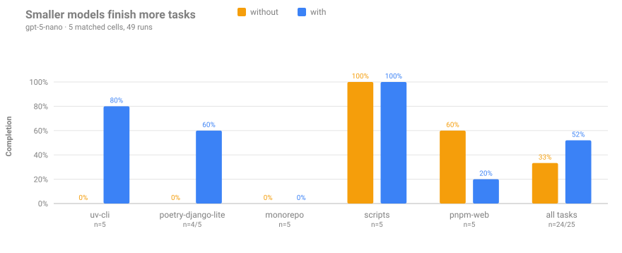
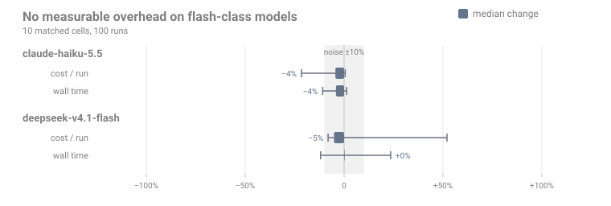

# Benchmark

Does bashlight help an agent finish real work, or does it only make the transcript look
tidier? We ran the same multi-step tasks through OpenCode **with** and **without** the
plugin and compared them. Two things came out of it:

- **Smaller models finish more tasks.** gpt-5-nano completed **52%** of the tasks with
  bashlight against **33%** without (13/25 vs 8/24). On the two tasks where it reached
  for the wrong Python tooling, it went from **0/9 to 7/10**.
- **No measurable overhead on flash-class models.** claude-haiku-5.5 and
  deepseek-v4.1-flash completed every task either way; the median change in cost per run
  was −4% and −5%, and in wall time −4% and 0% — within the noise of the measurement.

150 runs, $1.08 in total. Everything below can be re-derived from
[`bench/HEADLINES.json`](https://github.com/OffworldNexus/bashlight/blob/develop/bench/HEADLINES.json)
and
[`bench/RESULTS.md`](https://github.com/OffworldNexus/bashlight/blob/develop/bench/RESULTS.md).

## Smaller models finish more tasks



The gain is where bashlight actually stepped in: on `uv-cli` and `poetry-django-lite`
the model kept running `pytest`, `python` and `pip` outside the project's environment,
and bashlight rewrote 3–6 commands per run into `uv run …` / `poetry run …` /
`uv add …`. Where bashlight had nothing to correct, the results are noise in both
directions: `pnpm-web` went 3/5 → 1/5 with zero rewrites in the "with" runs, and the
monorepo task is beyond this model in both modes. Finishing more tasks also means longer
runs: gpt-5-nano's mean cost per run rose from $0.0053 to $0.0063.

## No measurable overhead on flash-class models



Flash-class models mostly use the right tools by themselves, so bashlight has less to do
— about one rewrite per run. Each square is the median change across the five tasks;
whiskers span the tasks. Cells where bashlight rewrote nothing still swing by ±20–50%,
so we read anything inside ±10% as "no difference": the plugin costs nothing measurable
on these models, and we make no cost-saving claim for them.

## How it was measured

| Project              | Toolchain                        | The task                                                               |
| -------------------- | -------------------------------- | ---------------------------------------------------------------------- |
| `monorepo`           | Poetry API + pnpm front, no root | add an API helper using python-slugify and a client parser using zod   |
| `uv-cli`             | uv, with ruff and mypy           | add `table` (tabulate) and `config` (PyYAML) subcommands, tests, lint  |
| `poetry-django-lite` | Poetry, executable `./manage.py` | add a `report` command (PyYAML) writing a CSV, run it, test it         |
| `scripts`            | none — just a data file          | convert `data.yaml` to `data.csv` with a kept Python script (PyYAML)   |
| `pnpm-web`           | pnpm, vitest, tsc, eslint        | add `formatRelative` (dayjs) and `parseItem` (zod), tests, types, lint |

- Prompts describe the feature and the libraries it uses, never the toolchain: the agent
  has to discover Poetry, uv or pnpm by itself. Each task has an objective checker
  (tests, linters, type checker, declared dependencies, produced files).
- Every run is headless (`opencode run --format json`) in a fresh copy of the project,
  with an isolated OpenCode configuration: no MCP servers, no personal instructions, no
  other plugins. In "with" runs bashlight is installed in that configuration, like a
  user would, never inside the project.
- 3 models × 5 projects × 2 modes × 5 repetitions. Only **matched cells** are compared
  (a project × model pair with runs in both modes), each weighted once; changes are the
  median of the per-cell changes. One run that hit the harness timeout is excluded.

**Caveats.** Five repetitions per cell show the completion effect on gpt-5-nano clearly
but leave cost and time differences under about ±10% indistinguishable from noise. The
tasks are small (from a few seconds to under three minutes of agent time); longer
sessions accumulate more misfired commands, which we have not measured. Results are for
these models, prices and OpenCode 2.2.5.

## Running it

```console
$ bun bench/run.ts --repeat 5 --jobs 3 --max-cost 3   # the full matrix, capped at $3
$ bun bench/report.ts                                  # RESULTS.md, HEADLINES.json, charts
```

The runner reads the OpenRouter key from your OpenCode credentials, passes it only to
the child processes, stops before a run whose projected cost would exceed `--max-cost`,
and prunes each run's directory once its metrics are extracted. See
[`bench/README.md`](https://github.com/OffworldNexus/bashlight/blob/develop/bench/README.md).
