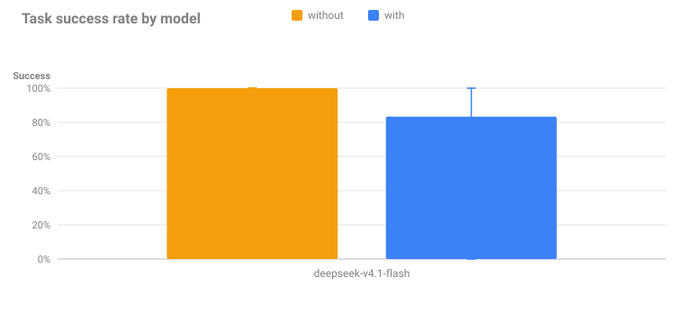
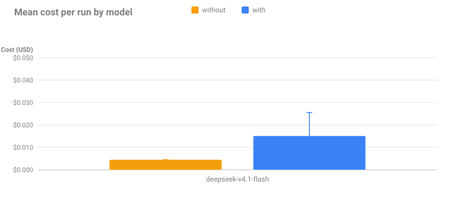
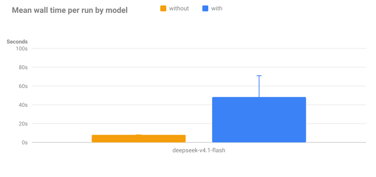
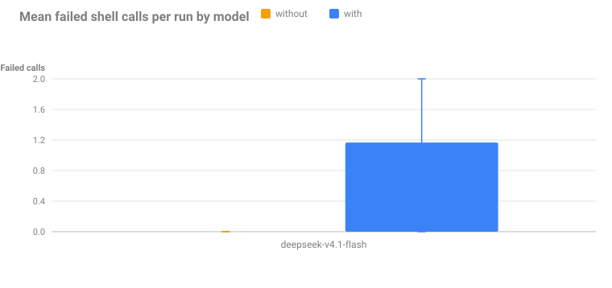
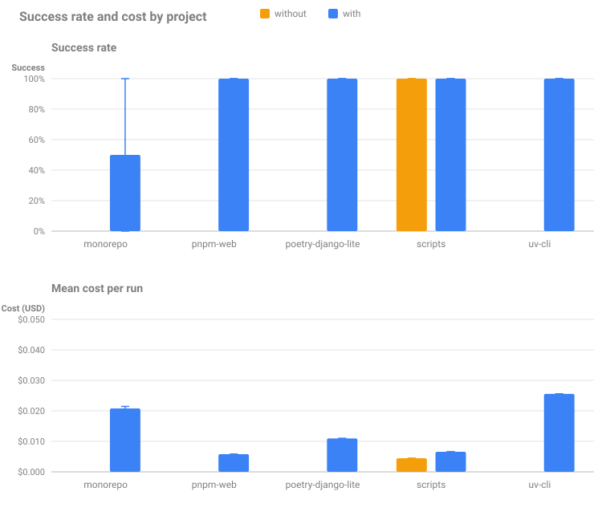

# Benchmark

Does bashlight help an agent finish real work, or does it only make the transcript look
tidier? This benchmark answers that by running the same tasks through OpenCode twice —
once **with** the plugin and once **without** — and comparing success, cost, time and
shell friction.











Every chart has one bar per mode (amber = without the plugin, blue = with it) for each
model or project; the whiskers span the runs, so a wide bar means unstable behaviour
rather than a precise average. The committed figures come from the last full run —
regenerate them with `bun bench/report.ts`.

## What this shows

- **Friction is where the gap lives.** The tasks are multi-step and touch more than one
  toolchain, so the agent's own `cd`, manager and interpreter choices matter. A run that
  keeps running the wrong command fails more shell calls and spends more tokens
  retrying.
- **Cost and time track the retries, not the model alone.** When the plugin rewrites
  `pip install` → `poetry add` or `python x.py` → `uv run x.py`, the command succeeds
  the first time instead of erroring and being re-run.
- **Success rates are dominated by the model.** A capable model tends to discover the
  toolchain anyway; the plugin still saves it the failed attempts. Weak models fail
  either way, and the chart makes that visible instead of hiding it behind an average.

## The tasks

Five projects, each with one realistic prompt and an objective checker. None of the
prompts names the toolchain: the agent has to discover it.

| Project              | Toolchain(s)         | Task                                                                     |
| -------------------- | -------------------- | ------------------------------------------------------------------------ |
| `monorepo`           | Poetry **+** pnpm    | add an API slug helper and a matching web validator, both suites green   |
| `uv-cli`             | uv + ruff + mypy     | add a `table` and a `config` subcommand; tests, lint and types must pass |
| `poetry-django-lite` | Poetry + `manage.py` | add a `report` command that reads YAML and writes a CSV, then run it     |
| `scripts`            | none                 | convert `data.yaml` to `data.csv` with a kept Python script              |
| `pnpm-web`           | pnpm + vitest        | add a dayjs util and a zod validator; tests, `tsc` and eslint must pass  |

The interesting cases are deliberate:

- `monorepo` has **no toolchain at the root**, so the agent must work in `api/` and
  `web/` — exactly where bashlight's static `cd` tracking pays off.
- `uv-cli` and `pnpm-web` chain a test command, a linter and a type checker, so one
  wrong runner fails three commands.
- `poetry-django-lite` ships an executable `./manage.py`; running it without the project
  environment fails once the new dependency is needed.
- `scripts` has **no project at all**: there `pip install` is blocked with a PEP 723 /
  `uv run` message and `python x.py` becomes `uv run x.py`.

A checker passes only when the project's own commands exit zero _and_ the new dependency
is declared, so vendoring the code is not a shortcut.

## Method

Each cell (project × mode × model × repeat) runs `opencode run --format json` headlessly
in a **fresh copy** of the project on an isolated XDG tree and `HOME`, with a minimal
`opencode.json` that has no MCP servers and no plugins other than bashlight. The only
difference between the two modes is the plugin. Runs execute several at a time
(`--jobs`, default 3) with a projected-cost cap, and every figure below is parsed from
the run's own event stream and bashlight audit log.

Three cheap, tool-capable models stand in for "a decent agent":

- `deepseek/deepseek-v4.1-flash`
- `openai/gpt-5-nano`
- `anthropic/claude-haiku-5.5`

Recorded per run: success, cost, input/output tokens, wall time, shell calls, failed
shell calls, bashlight rewrites and blocks, and the time to the last passing test
command. `bench/RESULTS.md` holds the full tables, including a per-project breakdown.

## Honest caveats

- **Small n.** Three repeats per cell show a trend, not a precise success-rate effect;
  treat single-digit differences as noise.
- **Fake projects.** The templates are small on purpose. They reproduce the command
  friction, not the complexity of a real repository.
- **One harness, one version.** The numbers move with the OpenCode release, the model,
  and the plugin itself; the committed charts are a snapshot, refreshed by the runner.
- **Cost is the provider's number.** It comes from the model's own usage accounting and
  excludes any fixed overhead.

## Running it

```console
$ bun bench/run.ts --repeat 3 --jobs 3 --max-cost 5   # the full matrix, capped at $5
$ bun bench/report.ts --all                           # merge every run: RESULTS.md + charts
```

The runner reads the OpenRouter key from your OpenCode credentials and passes it only to
the child process, never writing it down. It stops before a run whose projection — spend
so far plus the mean cost of completed runs, times the runs in flight — would exceed
`--max-cost`. See
[`bench/README.md`](https://github.com/OffworldNexus/bashlight/blob/develop/bench/README.md)
for the flags and the isolation details.
