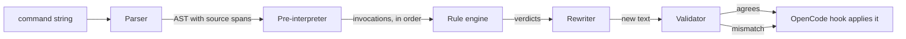

# How it works

bashlight never runs a command to understand it. Everything below happens on the command
string, before anything is executed. The full contract is in
[`DESIGN.md`](https://github.com/OffworldNexus/bashlight/blob/develop/DESIGN.md); this
page is the tour.

## The pipeline



Each stage is a pure function of its inputs:

1. **Parser** — a hand-written lexer and recursive-descent parser for the bash subset
   agents actually write: lists, pipelines, prefix assignments, redirections, heredocs,
   loops, conditionals, functions, and every word form (`$x`, `${x:-y}`, `$(…)`,
   `$((…))`, `<(…)`, brace expansion…). Every node carries a source span.
2. **Pre-interpreter** — walks the AST with an environment and emits every simple
   command that _would_ run, in source order, including commands inside command
   substitutions, loop bodies and branches. It tracks variables, `cd`, the working
   directory, and wrappers.
3. **Rule engine** — hands each command (with its argv, environment and working
   directory) to the [rules](rules.md). Rules say "keep", "replace with this argv" or
   "block".
4. **Rewriter** — turns those verdicts into the smallest edit of the original source
   that expresses them.
5. **Validator** — re-parses and re-interprets the edited source and checks that every
   rewritten command now produces exactly the argv the rule asked for, and that
   untouched commands are still untouched. If anything disagrees, the original command
   is used.

The result is one of three things:

| Outcome       | Meaning                                                  |
| ------------- | -------------------------------------------------------- |
| **unchanged** | the command runs as the agent wrote it                   |
| **rewritten** | a new command string runs; the agent never sees it       |
| **blocked**   | the command does not run, and the agent gets the message |

## Origins: why `$P` is edited at its declaration

Expansion does not produce plain strings — it produces fragments that remember where
they came from. A fragment's origin is one of _literal_ (written in the source),
_binding_ (a `$VAR`), _computed_ (a tilde or arithmetic result) or _unknown_ (a command
substitution, a positional parameter).

That is what lets bashlight edit the right place. Given this, in a Poetry project:

```bash
P="python"; $P main.py; $P test_orders.py
```

the interpreter knows that `python` comes from the _binding_ `P`, used twice. Rewriting
the two uses independently would miss the point, and rewriting only one would break the
factorization. So the rewriter edits the declaration:

```bash
P="poetry run python"; $P main.py; $P test_orders.py
```

But it may only do that when **every** use of the binding receives the same change. Here
it may not, so it falls back to editing just the one use:

```bash
P="python"; $P main.py; echo $P
# becomes
P="python"; poetry run $P main.py; echo $P
```

Origins also tell the rewriter which words are safe to touch: a word that is a single
literal can be replaced or deleted directly, while a word mixing literals and expansions
has to be re-quoted as a whole.

## The rewrite strategies, most surgical first

First, a whole-script pass looks for **binding edits**: a contiguous run of replaced
arguments that is exactly all the fields of one `$VAR` expansion is rewritten in that
variable's assignment — but only if every use of the binding, anywhere in the script,
gets the same change. Then, for each remaining rewritten command, the rewriter tries
these in order and stops at the first that works:

1. **Word-level edit.** Insert, replace or delete whole source words — only words that
   are literal and produce one field, so quoting is irrelevant.
2. **Inline.** Replace the whole word containing the expansion with the quoted new
   values, abandoning the factorization for that one use.
3. **Regenerate the command's words.** When every value is known and no redirection is
   interleaved, replace the span from the first to the last word of the effective
   command with the quoted new argv.
4. **Give up on that command.** The other commands in the script are still rewritten.

Environment variables a rule wants to inject become `K=V` before the command, or
`env K=V` before the effective `argv[0]` when the command is wrapped.

## The validator, and failing open

The validator is the reason bashlight can rewrite aggressively without being reckless.
The new text is not trusted because a rule _said_ so; it is re-parsed and
re-interpreted, and the resulting argv must match what the rule intended exactly. A
mismatch means the edit meant one thing and said another, so the original command runs.

That is one instance of the rule that governs the whole project: **bashlight fails
open.** It must never break a command. Unparseable input, an unknown value, a missing
shebang, an edit conflict, a validation failure, an internal exception — all of them
leave the command exactly as written. The only deliberate exception is an explicit
`block` verdict.

## The OpenCode hook

The plugin registers `execute.before` and handles events whose tool is `shell` (or the
legacy `bash`). It resolves the working directory from the event against the session's
directory, runs the pipeline, and then:

- on **rewritten**, mutates `event.input.command` — and this is the part that makes the
  whole illusion work. OpenCode persists the tool part's input from the provider's
  original tool-call event _before_ the hook runs. The model therefore keeps seeing
  **its own** command in the conversation, while the rewritten one is what actually
  executes.
- on **blocked**, throws an `Error(message)`; OpenCode turns that into a tool error
  result the model reads and reacts to.
- on any internal failure, catches it, logs it, and lets the command run unchanged.

Every call is also written to the [audit log](monitoring.md#the-audit-log),
independently of the verdict, so a broken log can never change what runs.

## Shebangs

When a command's `argv[0]` is a path — `./manage.py`, `scripts/report.py`, `./bin/cli` —
bashlight resolves it against the working directory and reads its `#!` line. The rule
then maps the _interpreter_ the script really runs, not the path that was typed:

```bash
./manage.py migrate            # #!/usr/bin/env python
# in a Poetry project becomes
poetry run ./manage.py migrate
```

An absolute interpreter like `#!/usr/bin/python3` bypasses `PATH`, so the runner is
followed by an explicit `python`. A missing shebang, an unknown working directory, or an
interpreter that is neither Python nor Node (`bash`, `sh`…) leaves the command
untouched.

## Remote hosts

`ssh`, `docker exec`, `docker compose exec` and `kubectl exec` are parsed as _wrappers_:
bashlight knows the command inside them will run, and where it runs, but the host is
remote and the working directory is unknown. Built-in rules declare themselves
local-only, so a remote command is interpreted but never rewritten:

```bash
ssh example.com 'cd /srv/app && python manage.py check'
# unchanged — we cannot see /srv/app from here
```

## Keep reading

- [Rules](rules.md) — the five built-in rules and the extension point.
- [Monitoring](monitoring.md) — the audit log and the CLI.
